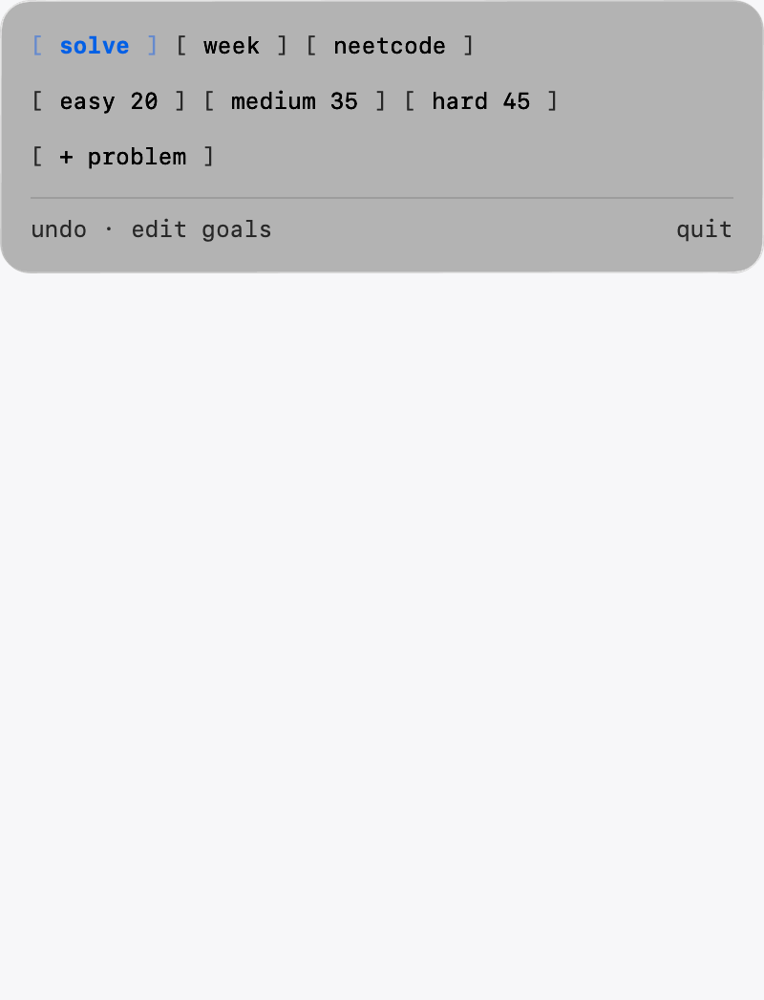

# Dialed

A macOS menu bar app for LeetCode prep: a problem timer, weekly targets, and a NeetCode 150 / Blind 75 checklist.



## Build

```sh
xcodebuild -project Dialed.xcodeproj -scheme Dialed -configuration Release -derivedDataPath build build
cp -R build/Build/Products/Release/Dialed.app /Applications/
```

Requires macOS 14+.
